# Cafetería asíncrona

Una cafetería universitaria donde pides desde el teléfono y la respuesta llega de inmediato: "pedido recibido, número 11". Desde ahí la cocina trabaja por su cuenta y el pedido avanza solo por `recibido`, `preparando` y `listo`. Nadie se queda mirando la pantalla mientras le preparan el café; la página consulta el estado cada pocos segundos y te avisa cuando puedes ir a recogerlo.

Para lograrlo, el backend no le pide nada a la cocina directamente. Guarda el pedido en Firestore, deja un mensaje en un tema de Pub/Sub y responde. Pub/Sub le entrega ese mensaje a la cocina, un servicio privado en Cloud Run que nadie más puede llamar. La plantilla trae las tres aplicaciones completas y la infraestructura del frontend y el backend; tu grupo construye en Terraform todo lo que conecta al backend con la cocina.

| Pedir | Seguir el pedido | Pantalla de la cafetería |
|---|---|---|
|  |  | 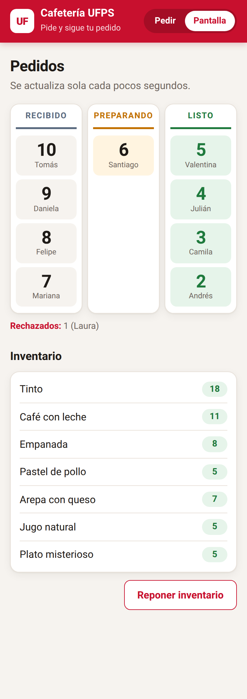 |

Si el frontend no logra hablar con el backend, lo dice en vez de quedarse en blanco:


## Arquitectura al terminar la práctica

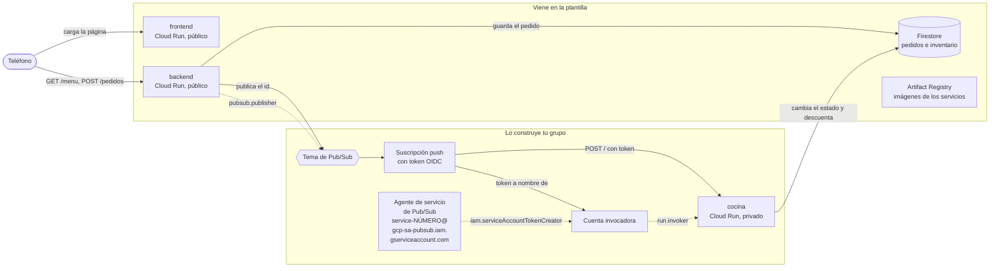

Las flechas punteadas son los permisos de IAM que da tu grupo. La etiqueta es el rol sin el prefijo `roles/` y la flecha llega al recurso sobre el que se da: el backend puede publicar solo en ese tema, el agente de Pub/Sub puede firmar tokens como la cuenta invocadora y esa cuenta puede invocar solo a la cocina.

En la plantilla, el backend ya sabe publicar, pero la variable `TEMA` está vacía: guarda el pedido, registra una advertencia y no avisa a nadie. Por eso, recién desplegada, la cafetería recibe pedidos que se quedan en `recibido` para siempre.

## Estructura del repositorio

```
backend/main.py            API en Flask: menú, pedidos, inventario y publicación en Pub/Sub
backend/requirements.txt   Dependencias del backend con versión fija
backend/Dockerfile         Imagen del backend con gunicorn
cocina/main.py             Worker que recibe las entregas push y prepara los pedidos
cocina/requirements.txt    Dependencias de la cocina con versión fija
cocina/Dockerfile          Imagen de la cocina con gunicorn
frontend/index.html        La página: vista para pedir y pantalla de la cafetería
frontend/server.py         Servidor sin dependencias que inyecta BACKEND_URL en la página
frontend/Dockerfile        Imagen del frontend
infra/providers.tf         Versión de Terraform y del proveedor de Google
infra/variables.tf         Proyecto, prefijo, región e imágenes
infra/main.tf              APIs, registro, Firestore, backend y frontend con sus cuentas
infra/outputs.tf           Ruta del registro y URL de los servicios
infra/terraform.tfvars.example   Ejemplo de valores; cópialo como terraform.tfvars
docs/api.md                Endpoints del backend y formato del mensaje de Pub/Sub
docs/estados.md            Ciclo de vida de un pedido y quién hace cada cambio
docs/capturas/             Capturas de la aplicación usadas en este README
.gitignore                 Deja por fuera el estado de Terraform, tus tfvars y __pycache__
```

## Cómo empezar

### Flujo de trabajo

1. Crea el repositorio de tu grupo con **Use this template** en GitHub.
2. Edita en VS Code o en github.dev (tecla `.` en la página del repositorio).
3. Haz commit y push desde el editor.
4. En Cloud Shell clonas la primera vez y traes los cambios con `git pull` después. Desde Cloud Shell nunca haces push.
5. Docker y Terraform se ejecutan siempre en Cloud Shell. La consola de Google Cloud es para mirar y diagnosticar, no para crear recursos.

### Primer despliegue

En Cloud Shell:

```bash
git clone https://github.com/<tu-usuario>/<tu-repositorio>.git
cd <tu-repositorio>/infra
cp terraform.tfvars.example terraform.tfvars
cloudshell edit terraform.tfvars
```

En `terraform.tfvars` pon el ID de tu proyecto y el prefijo del grupo, y ajusta las rutas de las imágenes a esos mismos valores. Este archivo vive solo en Cloud Shell: el `.gitignore` evita que llegue a GitHub.

El orden importa, porque las imágenes necesitan el registro y los servicios necesitan las imágenes:

```bash
# 1. Solo el registro (y las APIs de las que depende)
terraform init
terraform apply -target=google_artifact_registry_repository.registro

# 2. Las imágenes
REGISTRO=$(terraform output -raw registro)
gcloud auth configure-docker us-central1-docker.pkg.dev --quiet
cd ..
docker build -t $REGISTRO/backend:v1 backend
docker push $REGISTRO/backend:v1
docker build -t $REGISTRO/frontend:v1 frontend
docker push $REGISTRO/frontend:v1

# 3. Todo lo demás
cd infra
terraform apply
terraform output
```

Abre `url_frontend` en el teléfono. Si usas otra región, cambia `us-central1` en el comando de `gcloud auth configure-docker`.

Cuando cambies el código de un servicio, construye y sube la imagen con una etiqueta nueva (`v2`, `v3`...), actualízala en `terraform.tfvars` y vuelve a aplicar. Si subes otra vez la misma etiqueta, Terraform no ve ningún cambio y Cloud Run sigue con la versión anterior.

## Probar cada servicio con `docker run`

Antes de subir una imagen, pruébala en Cloud Shell. Para ver una página servida en Cloud Shell usa **Vista previa en la Web** y elige el puerto.

**Frontend.** No necesita credenciales:

```bash
docker run --rm -p 8080:8080 -e BACKEND_URL=https://<url-del-backend> $REGISTRO/frontend:v1
```

Abre la vista previa en el puerto 8080. Si no pasas `BACKEND_URL`, verás el mensaje de error de la captura de arriba.

**Backend sin Firestore.** El contenedor arranca aunque no tenga credenciales; la validación de pedidos no toca la base, así que puedes comprobarla:

```bash
docker run --rm -d --name backend -p 8081:8080 $REGISTRO/backend:v1
curl -i -X POST localhost:8081/pedidos -H 'Content-Type: application/json' -d '{"cliente": "Ana", "items": []}'
docker logs backend
docker rm -f backend
```

Debe responder `400` con el error en JSON.

**Backend con Firestore.** Cuando la base ya existe (después del primer `terraform apply` completo), puedes darle al contenedor tus propias credenciales:

```bash
gcloud auth application-default login
docker run --rm -d --name backend -p 8081:8080 \
  -e GOOGLE_CLOUD_PROJECT=<tu-proyecto> \
  -e BASE_DATOS=<prefijo>-cafeteria \
  -e GOOGLE_APPLICATION_CREDENTIALS=/adc.json \
  -v $HOME/.config/gcloud/application_default_credentials.json:/adc.json:ro \
  $REGISTRO/backend:v1
curl localhost:8081/menu
curl -X POST localhost:8081/pedidos -H 'Content-Type: application/json' \
  -d '{"cliente": "Ana", "items": [{"producto": "tinto", "cantidad": 1}]}'
```

**Cocina.** Escucha en `/` el mismo sobre que le entregaría Pub/Sub. Con las mismas credenciales, puedes hacerte pasar por Pub/Sub y entregarle a mano un pedido que esté en `recibido`:

```bash
docker build -t cocina cocina
docker run --rm -d --name cocina -p 8082:8080 \
  -e GOOGLE_CLOUD_PROJECT=<tu-proyecto> \
  -e BASE_DATOS=<prefijo>-cafeteria \
  -e GOOGLE_APPLICATION_CREDENTIALS=/adc.json \
  -v $HOME/.config/gcloud/application_default_credentials.json:/adc.json:ro \
  cocina
ID=<id de un pedido en recibido>
curl -i -X POST localhost:8082/ -H 'Content-Type: application/json' \
  -d "{\"message\": {\"data\": \"$(printf %s "$ID" | base64)\"}, \"deliveryAttempt\": 1}"
docker logs cocina
```

Responde `204` cuando termina, unos segundos después. Mira el pedido en la pantalla de la cafetería: acabas de hacer a mano lo que Pub/Sub va a hacer solo.

La cocina tiene dos variables para provocar fallas: `TIEMPO_PREPARACION` (segundos que tarda, 6 por defecto) y `PROBABILIDAD_FALLO` (entre 0 y 1; con esa probabilidad responde `500` después de haber terminado el trabajo). Los detalles están en [docs/api.md](docs/api.md) y el recorrido de un pedido en [docs/estados.md](docs/estados.md).

El plato misterioso falla siempre, y sin un tema de mensajes muertos Pub/Sub lo sigue reintentando mientras retenga el mensaje, que por defecto son 7 días. Cada intento deja un error en los logs de la cocina, así que se van a llenar hasta que tu grupo resuelva esa parte del reto.

---

# Informe del grupo

## Integrantes

| Nombre | Código | Usuario de GitHub |
|---|---|---|
| | | |

## URL de la cafetería

Frontend:

## Diagrama propio

<!-- Tu diagrama en Mermaid de lo que desplegaste, con los nombres reales de tus recursos. -->

## Evidencias por fase

## Fase 0. Preparación

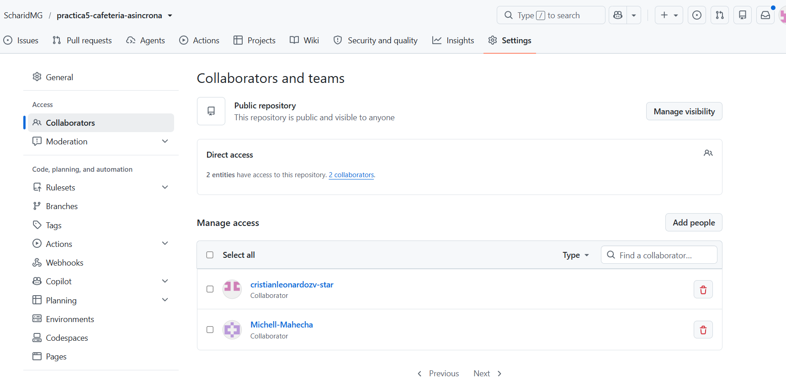

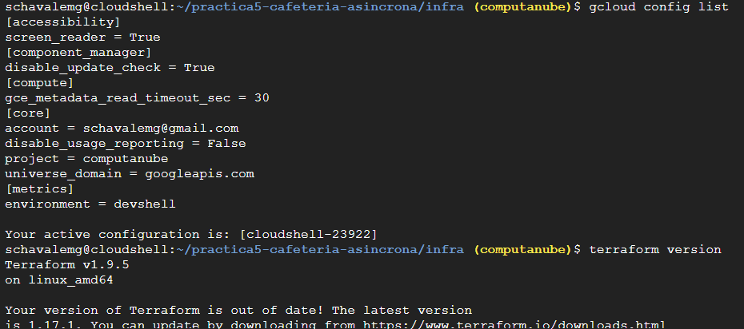

## Fase 1. Registro, imágenes y la base

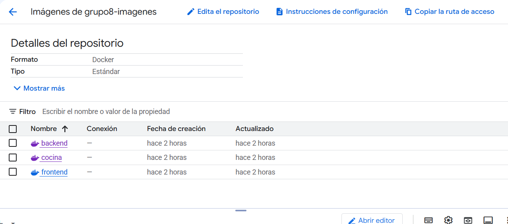

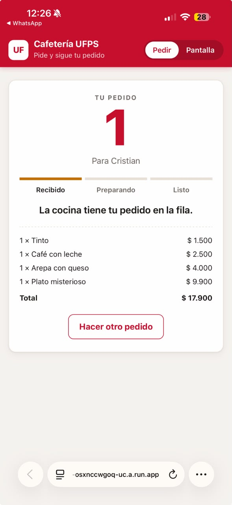

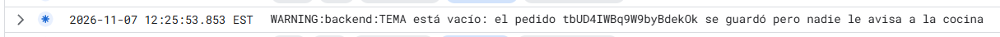

## Fase2. El tema

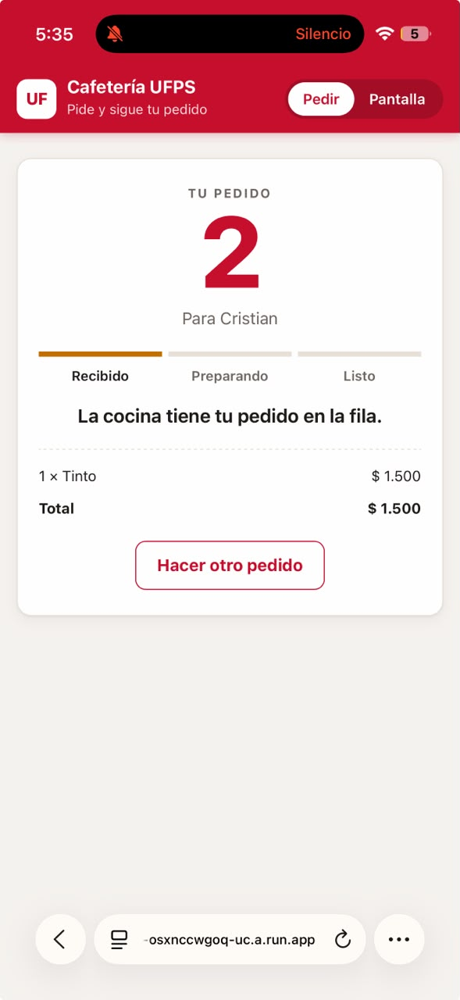

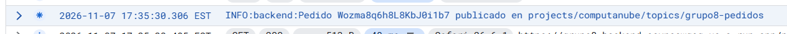

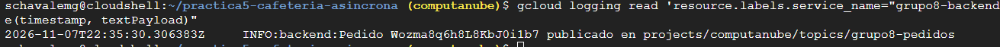

## Fase3. La cocina privada

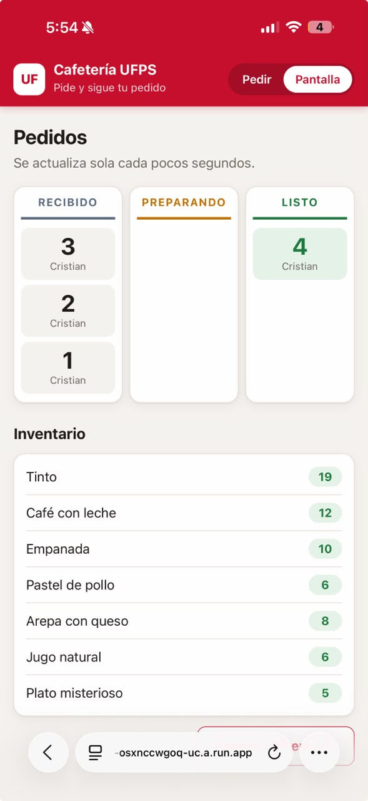

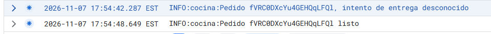

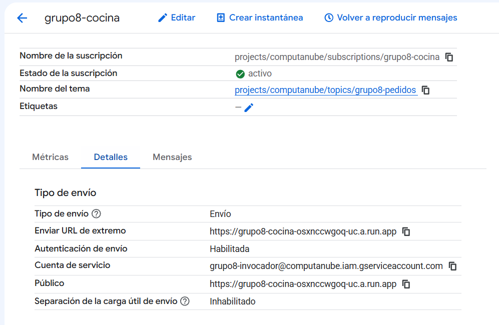

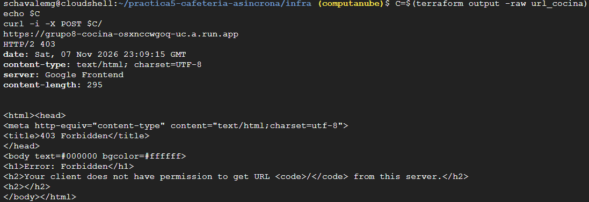

## Fase4. Lo asíncrono, visto

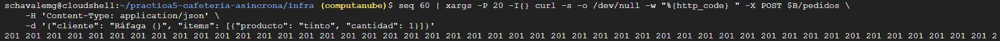

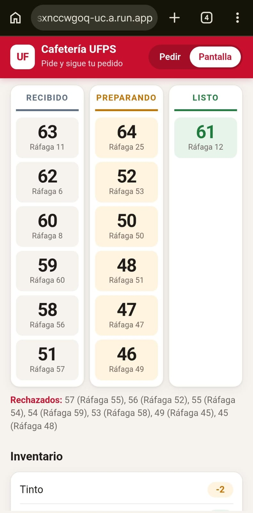

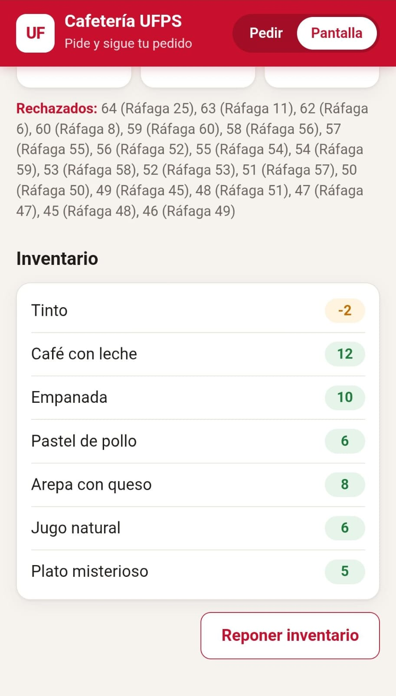

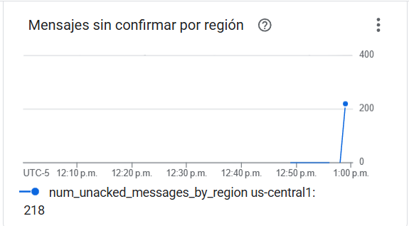

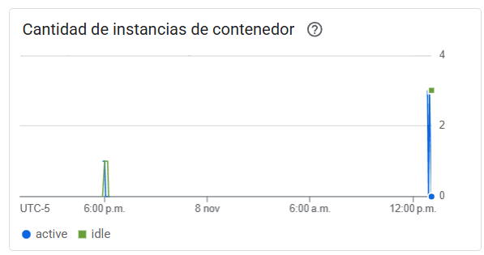

## Fase5. Una falla a propósito

Hicimos 4 pedidos de 1 tinto con `PROBABILIDAD_FALLO = 0.5`, partiendo de 20 tintos.

**Inventario después de los 4 pedidos:** quedaron 11 tintos.
Si cada pedido descontara una sola vez, deberían quedar 16.

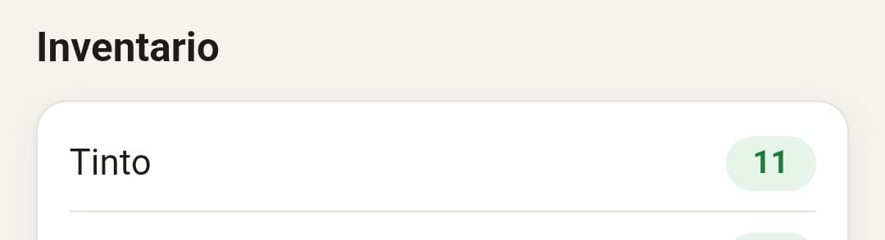

**Registros de la cocina:** cada pedido se procesó más de una vez.

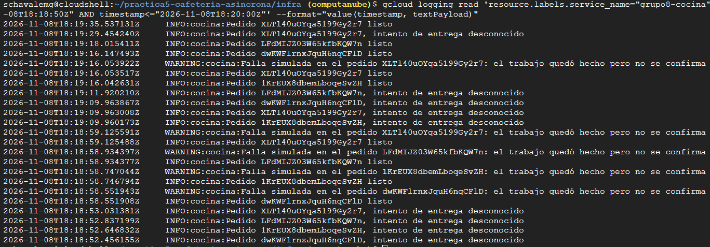

**El pedido XLTl40uOYqa5199Gy2r7 se preparó 3 veces:**

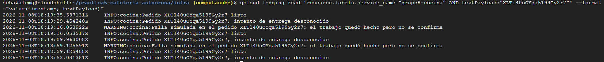

**La cuenta:**

| Pedido | Veces preparado |
|---|---|
| XLTl40uOYqa5199Gy2r7 | 3 |
| LFdMIJZ03W65kfbKQW7n | 2 |
| 1KrEUX8dbemLboqeSvZH | 2 |
| dwKWFlrnxJquH6nqCFlD | 2 |
| **Total** | **9 tintos descontados por 4 pedidos** |

La cocina terminaba el pedido y descontaba el inventario, pero respondía 500 antes de confirmar.
Pub/Sub no recibió el 2xx y volvió a entregar el mensaje, así que la cocina lo preparó de nuevo.
Esto muestra que Pub/Sub entrega **al menos una vez**, no **exactamente una vez**.

## Fase6. Reto de la semana: que cuadre

#### Idempotencia

Cambiamos `cocina/main.py` (imagen `cocina:v2`) y dejamos `PROBABILIDAD_FALLO = 0.5` para comprobar que el inventario cuadra aunque los pedidos lleguen repetidos.

**Prueba A: 4 pedidos de 1 tinto con la falla inyectada**

En los registros, 3 de los 4 pedidos fallaron después de quedar listos y Pub/Sub los volvió a entregar. En la segunda entrega, la cocina vio que ya estaban en `listo` y no los preparó otra vez:

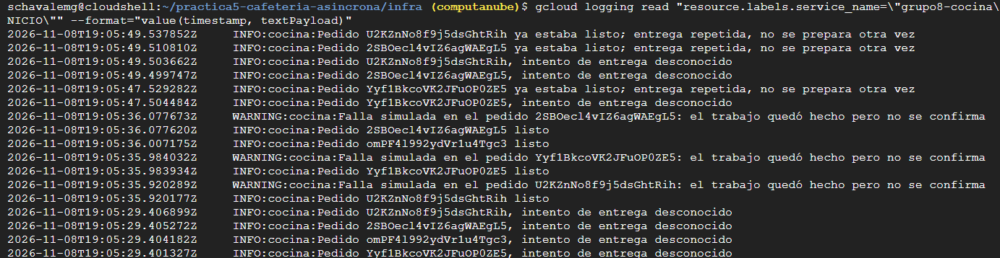

El inventario pasó de 20 a 16: exactamente 4 tintos por 4 pedidos.

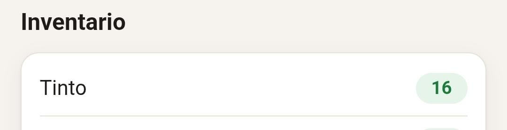

| | Cocina de la plantilla (fase 5) | Cocina idempotente (fase 6) |
|---|---|---|
| Pedidos | 4 | 4 |
| Entregas repetidas | 5 | 3 |
| Tintos descontados | 9 | 4 |
| Inventario final | 11 | 16 |

**Prueba B: ráfaga de 60 pedidos con 20 tintos**

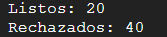

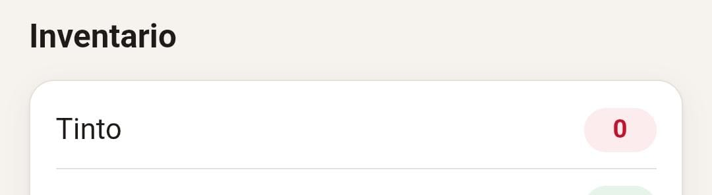

| | Fase 4 (plantilla) | Fase 6 (idempotente) |
|---|---|---|
| Pedidos en listo | __ | 20 |
| Pedidos en rechazado | __ | 40 |
| Tinto al final | __ (negativo) | 0 |

#### Mensajes muertos

Agregamos a `infra/pubsub.tf` un tema `grupo8-muertos`, su suscripción `grupo8-muertos` y una `dead_letter_policy` en la suscripción de la cocina con `max_delivery_attempts = 5`. El agente de Pub/Sub recibió `roles/pubsub.publisher` sobre el tema de muertos y `roles/pubsub.subscriber` sobre la suscripción de la cocina.

Pedimos un plato misterioso (pedido `rOtemV4O3m0fT06aPxto`). Ahora la cocina sí muestra el número de intento, porque `deliveryAttempt` solo llega cuando la suscripción tiene política de mensajes muertos. Se ven los intentos 1 a 5 y ninguno más:

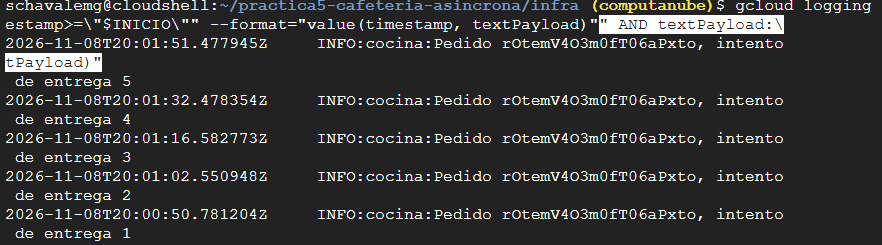

Después del quinto intento, Pub/Sub dejó de reintentar y movió el mensaje al tema de muertos. Lo leímos desde la suscripción `grupo8-muertos` con `gcloud pubsub subscriptions pull grupo8-muertos --limit=5`:

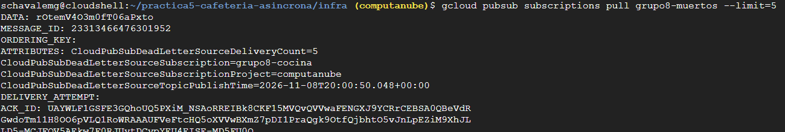

En la captura, `DATA` es el id del pedido, `CloudPubSubDeadLetterSourceDeliveryCount=5` dice cuántas veces se intentó entregar y `CloudPubSubDeadLetterSourceSubscription=grupo8-cocina` dice de qué suscripción vino. El pedido queda en `preparando` en la pantalla, porque la cocina nunca lo terminó, pero ya no llena los registros con reintentos durante 7 días.

#### Medir

Usamos `medir.py` (en la raíz del repositorio). El script repone el inventario, lanza 60 pedidos de un tinto (20 a la vez), consulta cada pedido cada segundo y mide desde el primer pedido creado hasta el último terminado, con las horas que guarda Firestore. Cambiamos el máximo de instancias de la cocina con la variable `max_instancias_cocina` (`terraform apply -var max_instancias_cocina=N`) y repetimos 3 veces por configuración, con `PROBABILIDAD_FALLO` apagada.

Comando: `python3 ../medir.py $(terraform output -raw url_backend) 60`

| Máx. instancias | Medición 1 | Medición 2 | Medición 3 | Promedio | Teórico |
|---|---|---|---|---|---|
| 1 | 66.7 s | 49.1 s | 49.0 s | 54.9 s | 48 s |
| 2 | 41.3 s | 40.2 s | 33.0 s | 38.2 s | 24 s |
| 3 | 31.7 s | 28.0 s | 26.9 s | 28.9 s | 18 s |

En todas las mediciones el backend aceptó los 60 pedidos en menos de 2 segundos, y siempre quedaron 20 listos y 40 rechazados (20 tintos en inventario).

- 3 instancias

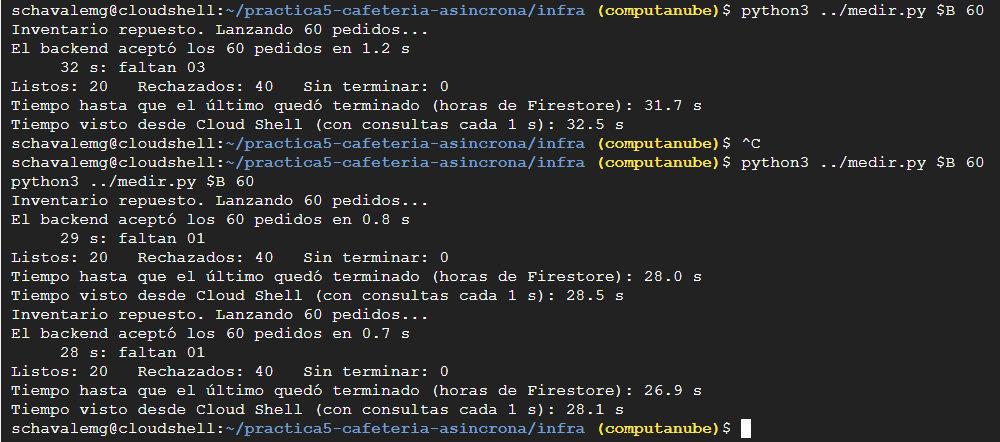

- 2 instancias

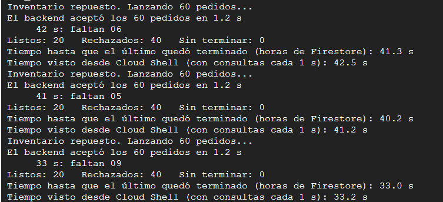

- 1 instancia

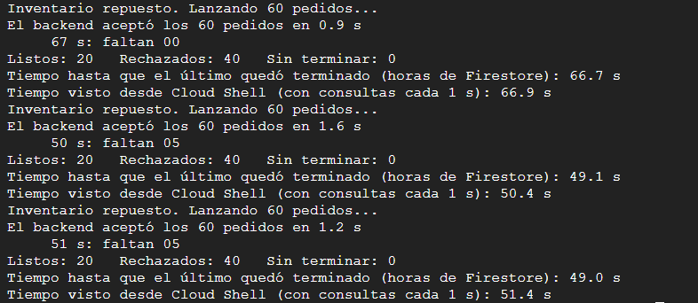

**Lecturas y escrituras de Firestore por pedido** (1 producto, sin repeticiones), contadas en el código:

| Quién | Lecturas | Escrituras |
|---|---|---|
| Backend, `POST /pedidos` (contador y pedido) | 0 | 2 |
| Cocina, al llegar (lee el pedido, lo marca `preparando`) | 1 | 1 |
| Cocina, transacción (pedido e inventario; descuento y `listo`) | 2 | 2 |
| **Total** | **3** | **5** |

Una entrega repetida suma 1 lectura. Cada repetición de una transacción por choque suma 2 lecturas. Un pedido rechazado cuesta 4 escrituras en vez de 5. Además, la pantalla de la cafetería lee hasta 20 pedidos cada 5 segundos mientras esté abierta, y el teléfono lee su pedido cada 5 segundos.


## Decisiones del reto

<!-- Qué cambiaste, por qué y cómo comprobaste que funciona. -->

## Preguntas

<!-- Las respuestas a las preguntas de la guía. -->
